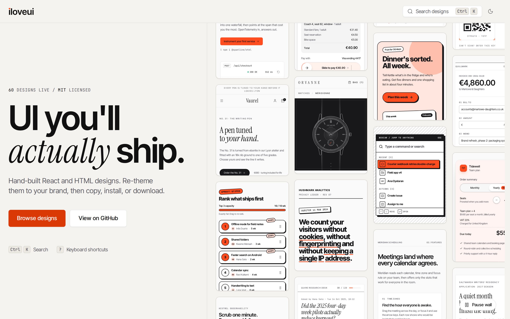
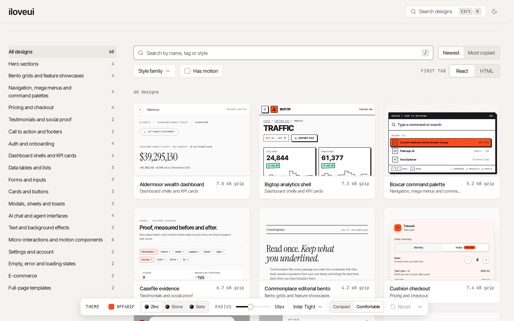
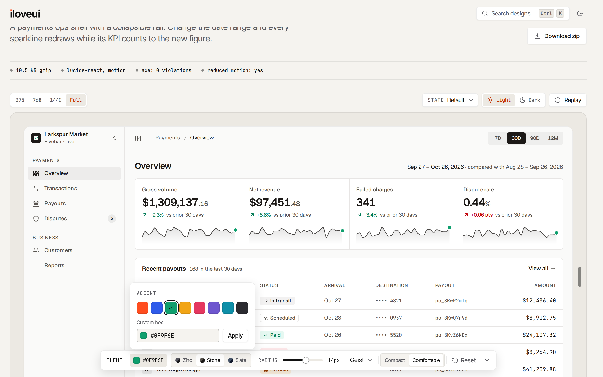
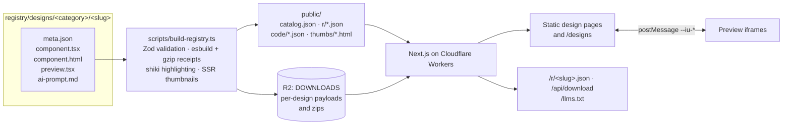

<p align="center">
  <picture>
    <source media="(prefers-color-scheme: dark)" srcset="docs/logo-dark.svg">
    
  </picture>
</p>

<p align="center">
  <strong>60 hand-built React and HTML designs you re-theme to your brand, then copy, install or download.</strong>
</p>

<p align="center">
  <a href="LICENSE"></a>
  
  
  
  
  
</p>

<p align="center">
  <picture>
    <source media="(prefers-color-scheme: dark)" srcset="docs/screenshots/home-dark.png">
    
  </picture>
</p>

iloveui is a catalog of production-ready UI and the site that shows it off. Every design is a complete piece of product UI (hero sections, pricing tables, dashboards, agent consoles, command palettes, micro-interactions) built in two formats, audited for accessibility in every state, and themed through ten CSS variables, so one Theme Lab setting re-skins all of them at once.

It is also a full-stack reference: a design registry with build-time receipts, a shadcn-compatible registry endpoint, and a complete paid-access architecture (accounts, licenses, payments, CLI tokens) that kept Pro source on the server. That architecture is switched off by default and every design is free under the MIT License.

## Screenshots

<table>
  <tr>
    <td width="50%">
      <picture>
        <source media="(prefers-color-scheme: dark)" srcset="docs/screenshots/designs-dark.png">
        
      </picture>
      <p align="center"><sub><b>/designs</b>: live thumbnails, URL-synced filters, Cmd+K search</sub></p>
    </td>
    <td width="50%">
      <picture>
        <source media="(prefers-color-scheme: dark)" srcset="docs/screenshots/theme-lab-dark.png">
        
      </picture>
      <p align="center"><sub><b>Theme Lab</b>: re-skin every preview, then copy code that carries your tokens</sub></p>
    </td>
  </tr>
</table>

<sub>Every screenshot has a light and a dark version and follows your GitHub theme. Regenerate them with `pnpm screenshots` while `pnpm preview` is running.</sub>

## Features

- **60 designs in 19 categories and 8 style families.** Swiss minimal, Editorial, Neo-brutalist, Soft tactile, Dark technical, Playful, Luxury and Data-dense, each with a written definition in [registry/style-families.md](registry/style-families.md). Every category has a craft brief the designs must meet.
- **Two formats per design.** A single typed `component.tsx` for React + Tailwind CSS v4, and a `component.html` with the same markup and vanilla JavaScript.
- **Theme Lab.** A dock on every browse and design page: accent (8 presets or any hex), neutral family, radius, font and density. Values reach every preview iframe by `postMessage` as `--iu-*` variables, persist in `localStorage`, and are written into the code you copy and the zip you download.
- **Preview stage.** 375, 768, 1440 and Full presets, a drag handle with the live width, light and dark, a state switcher (default, hover, focus, loading, empty, error, success and more) and a Replay button.
- **Receipts.** Every design shows its gzipped size, runtime dependencies, axe result and reduced-motion support, all measured at build time.
- **Agent-native.** `npx shadcn@latest add @iloveui/<slug>`, a Copy AI prompt button with your tokens appended, and an [llms.txt](https://iloveui.dev/llms.txt) index of the catalog.
- **Real states, both themes, every width.** Each design is rendered at 375, 768 and 1440 px in light and dark, in every state it declares, and must pass axe with zero violations and no horizontal overflow.
- **Fast to browse.** Static design pages, sandboxed iframe thumbnails that load near the viewport and pause offscreen, client-side Fuse.js search, and keyboard shortcuts (Cmd/Ctrl+K, `/`, `T`, `C`, `?`).

## Tech stack

| Layer                      | Choice                                                                                              |
| -------------------------- | --------------------------------------------------------------------------------------------------- |
| Framework                  | Next.js 16 (App Router), React 19, TypeScript strict with `noUncheckedIndexedAccess`                |
| Styling                    | Tailwind CSS v4 with CSS-first `@theme` tokens in OKLCH, `clsx` + `tailwind-merge`                  |
| UI and motion              | Radix UI primitives, `motion/react`, `lucide-react`                                                 |
| Code                       | `shiki` on the server with light and dark themes derived from the site tokens                       |
| Runtime                    | Cloudflare Workers through `@opennextjs/cloudflare`, D1 (Drizzle ORM) and R2                        |
| Search                     | A JSON index built at build time, searched with Fuse.js                                             |
| Testing                    | Vitest, Playwright, `@axe-core/playwright`; esbuild for bundle receipts                             |
| Paid path (off by default) | Clerk for identity, Dodo Payments plus a local test checkout behind one `PaymentProvider` interface |

## Architecture



### The registry

Each design is a folder of six files. `meta.json` is validated with Zod ([registry/schema.ts](registry/schema.ts)); `scripts/build-registry.ts` then bundles `component.tsx` with esbuild (React external) to measure its gzipped size, server-renders every state for the static thumbnails, highlights the code with shiki, and emits the search index, the receipts and a registry item per design that matches the [shadcn registry-item schema](https://ui.shadcn.com/schema/registry-item.json). Unchanged designs come from a content-hash cache, so rebuilds take about a second. `scripts/build-zips.ts` packs each design with its AI prompt and license into R2.

### Theme Lab and the token contract

Designs never hard-code a brand color. They read ten variables (`--iu-accent`, `--iu-accent-foreground`, `--iu-background`, `--iu-surface`, `--iu-border`, `--iu-foreground`, `--iu-muted`, `--iu-radius`, `--iu-font`, `--iu-density`), with separate light and dark values. Theme Lab computes those values from five inputs ([lib/theme.ts](lib/theme.ts)), posts them to every preview frame, and rewrites the token block when you copy or download. The thumbnails are static HTML with a small inline listener and no React, so a page full of them stays cheap.

### Receipts and audits

The receipt bar is data, not copy: esbuild measures the size, the bundle's externals become the dependency list, and the axe result comes from `registry/audits.json`, which the end-to-end suite rewrites after auditing each design at three widths in both themes. A receipt only shows "axe: 0 violations" for the exact content hash that was audited.

### Entitlements, and how Pro source stayed on the server

The site launched with 24 free designs and a paid Pro tier. That design is still in the code, behind `MONETIZATION_ENABLED`:

- **One function decides access.** [lib/entitlements.ts](lib/entitlements.ts) answers "does this user have Pro" from D1 alone: an active license they own, or an active seat on someone's Team license. Clerk owns identity only; every route, page and the registry endpoint asks the same function.
- **Pro source never became a public file.** The build split its output: free registry items and code went to `public/`, Pro payloads only to the private R2 bucket. A unit test scans every public artifact for distinctive lines of every Pro design and fails on any match.
- **Locked pages were real pages.** Pro design pages were statically rendered with a locked panel built from file names and line counts only; the source arrived through `/api/code/<slug>` after a server-side entitlement check. The live preview ran for everyone.
- **CLI tokens.** `ilui_live_` plus 32 base62 characters from `crypto.getRandomValues`, stored only as a SHA-256 hash with a server-side pepper, shown once, one per user, with `lastUsedAt` tracking. `/r/<slug>.json` answered 401 without a valid token and 403 without a license, both with a message the shadcn CLI prints.
- **Payments behind an interface.** [lib/payments/provider.ts](lib/payments/provider.ts) has two implementations: Dodo Payments, and a local test checkout that exists only in development builds (a post-build check fails any production bundle that contains it). Both webhooks run one fulfilment function that verifies the signature, ignores duplicate events, and grants or revokes licenses. Access was never granted from a return URL.
- **Rate limits** used a fixed-window counter in D1: 120 registry requests per token per minute, 60 downloads per user per hour, 10 checkouts per user per hour.

With the flag off (the default), the build serves every design as free, every account, payment and Pro route answers 404, and Clerk never runs, so no keys are needed. Set `MONETIZATION_ENABLED=true` in `.env.local` to turn it all back on; `MONETIZATION_PRO_SLUGS=slab-pricing,atelier-product-page` marks designs Pro for one build without editing their `meta.json`. Unit tests cover both flag states through the real route handlers, and the end-to-end suite runs the full sign-in, purchase, unlock, install, download and refund journey with the flag on.

<details>
<summary><b>Try the paid flow locally</b></summary>

1. In `.env.local`, set `MONETIZATION_ENABLED=true` and `MONETIZATION_PRO_SLUGS=atelier-product-page`, then run `pnpm setup` again. With the flag on it creates a temporary accountless Clerk development app (internet access, no Clerk account).
2. `pnpm dev`, then sign up at `/sign-up` with an address like `you+clerk_test@example.com`. Clerk sends no email for `+clerk_test` addresses; the code is always `424242`.
3. On `/pricing`, choose Pro. The local test checkout opens with a banner saying so. **Pay** sends a signed webhook to `/api/webhooks/local`, which runs the same fulfilment as the Dodo webhook.
4. Open `/designs/ecommerce/atelier-product-page`: the code, AI prompt and download unlock. Create a CLI token on `/account` and install with `npx shadcn@latest add @iloveui/atelier-product-page`.
5. Request a refund on `/account`: access and the token are revoked as soon as the refund event is processed.

Setting `DODO_PAYMENTS_API_KEY` switches checkout to Dodo Payments and turns the local checkout off; real Clerk keys in `.env.local` replace the accountless app. Nothing else changes.

</details>

## Quick start

You need Node.js 22.13 or newer and pnpm (the version is pinned in `package.json`; `corepack enable` installs it).

```bash
git clone https://github.com/jaisaljain/iloveui.git
cd iloveui
pnpm install
pnpm setup   # .env.local with generated secrets, local D1 migrations, registry build, download zips
pnpm dev     # http://localhost:3000
```

Everything runs locally: D1 and R2 are emulated by Wrangler, and no account or API key is needed. `pnpm preview` serves the production build in the local Workers runtime instead. On Windows, use WSL2 with Ubuntu and clone into the Linux file system (not `/mnt/c`).

## Quality gates

```bash
pnpm exec playwright install --with-deps chromium   # once
pnpm gates
```

`pnpm gates` runs, in order and stopping at the first failure:

| Gate                                      | What it checks                                                                                                                                                                                                                                    |
| ----------------------------------------- | ------------------------------------------------------------------------------------------------------------------------------------------------------------------------------------------------------------------------------------------------- |
| `pnpm typecheck`                          | Cloudflare binding types, a registry build and `tsc --noEmit`                                                                                                                                                                                     |
| `pnpm lint`                               | ESLint and Prettier with zero warnings, plus a scan for forbidden words and patterns                                                                                                                                                              |
| `pnpm test`                               | Vitest unit tests, including access control in both flag states and the Pro-source leak scan                                                                                                                                                      |
| `pnpm test:e2e`                           | Playwright against the production build in the Workers runtime: axe on every route in both themes, every design at 375, 768 and 1440 in light and dark with no horizontal overflow, then the paid journey against `next dev` with monetization on |
| `pnpm validate-registry --require-audits` | Every design folder against the authoring contract, with a passing axe audit for its current version                                                                                                                                              |

Pull requests run typecheck, lint, unit tests and registry validation in [GitHub Actions](.github/workflows/ci.yml).

## Add a design

1. Create `registry/designs/<category>/<slug>/` with `meta.json`, `component.tsx`, `component.html`, `preview.tsx`, `ai-prompt.md` and `notes.md`. The contract is [registry/README.md](registry/README.md); the style families are in [registry/style-families.md](registry/style-families.md) and the category briefs in section 9.3 of [CLAUDE.md](CLAUDE.md).
2. Check it on its own: `pnpm validate-registry --only <slug>` and `pnpm design:check <slug>`, which renders every state at every width in both themes, runs axe, and writes contact sheets to `test-results/design-check/<slug>/`.
3. Run `pnpm gates` and commit the updated `registry/audits.json` with the design.

[CONTRIBUTING.md](CONTRIBUTING.md) has the details.

### Batches with an agent

[BATCH.md](BATCH.md) is a self-contained instruction for adding 30 designs at a time. Open Claude Code in the repository and say:

```text
Execute BATCH.md
```

It picks the categories furthest below their targets, balances style families, follows every category brief, runs every gate, adds a changelog entry and commits as `catalog: batch N`.

## Project layout

```text
app/                 routes: site pages, /preview frames, /r registry endpoint, API routes
components/          site UI, Theme Lab, preview stage, design page, browse
registry/designs/    the catalog, one folder per design
registry/schema.ts   the meta.json schema
lib/                 catalog, theme, entitlements, payments, tokens, rate limits, search
scripts/             setup, build-registry, build-zips, validate-registry, design-check, gates
content/             docs and changelog (MDX)
tests/               unit (Vitest) and e2e (Playwright)
drizzle/             D1 migrations
CLAUDE.md            the full build specification
DECISIONS.md         every decision the specification left open
```

## Status

**Complete, not actively maintained.** The catalog, the site and the gates are finished and pass. Issues and pull requests may not get a response; forks are welcome.

## License

[MIT](LICENSE). Use the designs in personal and commercial projects.

Built by Jaisal K Jain.
